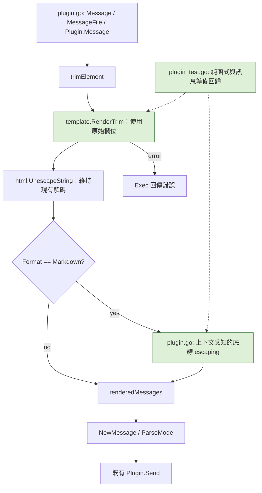

# Plan: 修正 Telegram Markdown 底線 escaping（telegram-action #30）

## Goal

讓使用 `drone-telegram` 與 `telegram-action` 的使用者，在 legacy `Markdown` 訊息的 inline code、code block、連結文字與 URL 中使用 `_` 時，不再被插件加入多餘的反斜線；一般文字與已跳脫底線維持既有行為。修正必須涵蓋直接訊息、訊息檔案、預設訊息及模板變數，並提供可離線執行的回歸測試。發布、留言或關閉 issue 不在本次範圍。

狀態：使用者已核准實作；程式與離線驗證完成。真實 Telegram 顯示驗證、人工 reviewer 審查與發布仍待後續進行。

## Evidence

- Issue：https://github.com/appleboy/telegram-action/issues/30
- Telegram legacy Markdown 規格：https://core.telegram.org/bots/api#markdown-style
- `plugin.go` 的 `escapeMarkdownOne` 先將 `\_` 還原成 `_`，再全域轉為 `\_`，未辨識語法位置。
- `Plugin.Exec` 在模板渲染前呼叫 `escapeMarkdown(message)` 與 `escapeMarkdownFields`，後者直接改寫 Commit、Build、Repo 欄位。
- 訊息實際路徑為：選擇來源 → trim → escaping → `template.RenderTrim` → `html.UnescapeString` → `NewMessage` / `ParseMode` → `Send`。
- `Plugin.Message` 的預設內容本身包含 inline code、fenced code 與裸 URL，因此預設訊息也要驗證。
- 現有 `TestEscapeMarkdown` / `TestEscapeMarkdownOne` 只涵蓋一般字串與已跳脫底線；診斷階段執行通過，不能證明 issue 情境正確。
- 調查時 `telegram-action` 的 Dockerfile 使用 `ghcr.io/appleboy/drone-telegram:1.5.1`；發布時需重新確認版本，不將此資訊當成永久現況。

## Classification: CORE CODE

依 `classify-change` 的六項判準：

| 判準 | 評估 |
| --- | --- |
| Q1 傳播範圍 | 共用 Markdown 訊息路徑，同時影響 Drone 與 GitHub Actions，偏 Core。 |
| Q2 變更頻率 | 此次是範圍有限的修正，預期穩定，偏 Leaf。 |
| Q3 技術債 | 語法辨識若持續堆疊字串替換，後續相容性難以維護，偏 Core。 |
| Q4 類型 | 共用格式轉換與渲染流程，屬 Core。 |
| Q5 失敗代價 | 可能讓既有通知格式錯誤、連結失效或 Telegram 拒收，偏 Core。 |
| Q6 審查方式 | 必須逐行檢查掃描邊界與渲染順序，不能只看測試通過，偏 Core。 |

建議由維護者確認設計，至少兩位 reviewer（含模組 owner）審閱，對修改的核心路徑逐行檢查；未取得實際審查前，不在 PR 宣稱已完成人工審查。

## Scope

### May modify

- `plugin.go`：底線 escaping、移除預先改寫資料欄位的行為、調整渲染與 escaping 順序；必要時抽出小型私有訊息準備函式供正式路徑與測試共用。
- `plugin_test.go`：table-driven 語法測試、模板與預設訊息回歸、錯誤傳遞測試。
- `tests/message_markdown*.txt`：僅在檔案來源回歸需要時新增 fixture；優先用 `t.TempDir()` 避免固定 fixture 膨脹。
- `README.md`：說明 legacy Markdown 的底線行為、相容性界線及 HTML workaround。
- `plan.md`：追蹤設計決策與驗證結果。

### Must not modify

- `main.go`、`main_test.go`：本次不新增 CLI flag、環境變數或修改 format 預設值。
- `go.mod`、`go.sum`：不新增或升級依賴。
- Bot client 建立、proxy、token 處理、重試、收件者選擇與傳送流程。
- 媒體、caption、message thread、通知與預覽選項。
- Dockerfile、CI、release workflow；發布另行處理。
- 外部 `telegram-action` repository、issue 與 PR 狀態。

## Existing patterns to follow

- 延續 `escapeMarkdownOne` 純函式及 `TestEscapeMarkdownOne` / `TestEscapeMarkdown` 的 table-driven 測試風格。
- 使用現有 `testify/assert` 與 `require`；不導入新的 parser 或測試 framework。
- 沿用 `template.RenderTrim`、`html.UnescapeString` 與目前模板變數合併順序（檔案覆蓋 inline JSON）。
- 保留 `Plugin.Message` 的訊息格式；在最終訊息準備層修正上下文問題。
- 現有 Telegram integration tests 使用 `skipIfNoTelegramSecrets`；新增離線測試不可依賴真實 token 或服務。

## Behavior contract

以下輸出是傳給 Telegram 的訊息文字，不是 Telegram UI 顯示值。

| 情境 | 輸入 | 預期輸出 |
| --- | --- | --- |
| 一般文字 | `user_name` | `user\_name` |
| 已跳脫一般文字 | `user\_name` | 不重複增加反斜線 |
| Inline code | 反引號包住 `_Some text` | 原樣保留 code 內容 |
| Fenced code | 三個反引號包住 `user_name` | 原樣保留，含跨行及語言標記 |
| Markdown link | `[_Some text](https://example.com/some_path)` | 原樣保留 label 與 target |
| 裸 HTTP(S) URL | `https://example.com/some_path?q=a_b#c_d` | 不插入反斜線 |
| 混合內容 | 一般文字、code、link 同時出現 | 只對一般文字套用既有底線處理 |
| 模板欄位 | 同一個含 `_` 的欄位出現在一般文字與 code/link | 依各次渲染後的位置處理，不改寫來源欄位 |
| HTML / 其他 format | 與目前相同輸入 | 不套用新 Markdown helper，保持原路徑行為 |

補充界線：

- 保持既有 `Format == formatMarkdown` 判斷；不順便修正大小寫或新增 MarkdownV2。
- 一般文字中的 `_italic_` 仍依既有底線逃脫行為處理；本次不重新定義底線斜體支援。
- code/link 內原本就存在的 `\_` 原樣保留，不推測使用者要刪除反斜線。
- 僅完整、可辨識的 code/link 區段取得保護；未閉合語法不將後續整段誤判成 code/link，退回一般文字處理，保留原有標記，不自動補齊。
- 辨識跳脫的反引號、方括號、括號及 URL 邊界；連結 target 應處理成對括號和跳脫括號，避免過早結束。裸 URL 到空白、控制字元或明確的外層語法邊界為止，不重新編碼 URL。
- 此 helper 不是完整 Markdown validator，也不保證修復使用者本來就不合法的訊息。
- 自訂 `tpl` 值原先未經欄位預先 escaping；改為渲染後處理會讓它們也遵循以上規則。這是刻意統一的行為變更，必須寫入文件與測試，尤其是含 `_italic_` 的值。

## Verification strategy

先建立會在舊實作失敗的測試，再改程式；不要只測新 helper 而漏掉真正的訊息準備流程。

三組使用者可觀察驗證情境：

1. 正常情境：直接訊息、訊息檔案與預設訊息包含 `_Some text`、code、link 與 URL。準備後 payload 正確，真實 Telegram 中 code 無多餘反斜線，點擊連結仍到達原 URL。
2. 錯誤邊界：未閉合 code/link、跳脫分隔符、連續反斜線、中文與 emoji 混合輸入不 panic、不截斷、不吞掉後續文字；未閉合區段遵循一般文字底線處理，仍由 Telegram 判斷格式是否合法。
3. 渲染失敗：使用已確認會讓現有模板引擎報錯的無效模板，保留錯誤傳遞，不將失敗當成空訊息或成功結果；訊息檔案不存在仍回傳原載入錯誤。

自動化測試分層：

- 純函式：涵蓋上表、空字串、跨行 code、相鄰區段、多個連結、URL query/fragment、成對括號、跳脫分隔符、既有 `\_` 與 Unicode。
- 訊息準備：測試共用的正式渲染路徑，涵蓋 `commit` / `build` / `repo` / `tpl`、同值不同上下文、HTML entity 解碼順序、來源資料不被改寫及重複準備的穩定性。
- 預設訊息：repo、branch、commit message、build URL 帶底線；驗證 Drone 與 GitHub 預設分支。
- HTML 與非 Markdown：對照原結果，確認新 helper 未介入。
- 人工端到端：發布前由維護者在專用測試 chat 驗證正常情境及 issue 原案例；離線 payload 測試不能冒稱驗證過 Telegram 的實際渲染。

離線檢查指令（實作完成後執行）：

```sh
rtk proxy env TELEGRAM_TOKEN= TELEGRAM_TO= go test ./...
rtk proxy env TELEGRAM_TOKEN= TELEGRAM_TO= go test -race ./...
rtk go vet ./...
rtk make fmt-check
rtk git diff --check
```

無壓力／長時間測試需求。掃描應避免反覆掃描相同尾段造成明顯平方級退化；以大量未閉合分隔符的離線案例檢查終止性與內容完整性。不新增日誌或 metrics；沿用既有錯誤傳遞，驗證結果記錄測試與人工檢查證據。

## Architecture / flow



綠色代表新增或調整的元件。關鍵順序是「原始欄位 → 模板渲染 → 現有 HTML 解碼 → Markdown escaping」，讓相同變數在不同位置接受不同處理。若需抽出私有準備函式，必須由 `Exec` 真正呼叫，避免僅為測試建立另一套流程。

## Implementation steps

1. 讀取適用的 AGENTS.md 與 `/Users/appleboy/.codex/RTK.md`；所有 shell 指令使用 `rtk`。確認工作樹，保留使用者既有修改。
2. 新增最小失敗案例：inline code、fenced code、link label/target、裸 URL 及模板值；先證明目前全域替換會失敗。
3. 在 `plugin.go` 實作有限範圍的掃描器，辨識完整 code/link/URL 區段並原樣複製，對其餘區段沿用普通文字底線規則。避免用單一大型 regexp 模擬所有語法。
4. 移除渲染前的 message / field escaping，將上下文處理放在渲染與 HTML 解碼之後。若 `escapeMarkdownFields` 已無呼叫者，刪除該 helper；不要留下兩條 escaping 路徑。
5. 補齊訊息準備、預設訊息與錯誤案例；保留來源選擇、trim、變數優先序、格式判斷及發送方式。
6. 更新 README，執行離線檢查，審查變更範圍與相容性差異。不要擴大成完整 Markdown parser 或順便重構發送流程。
7. 整理驗證證據與待人工驗證項目；實作任務到此結束，發布使用下列獨立清單。

## Done definition

- [x] 原 issue 的 code、link label 與含底線 URL 案例有修正前失敗、修正後通過的證據。
- [x] 三組驗證情境都有對應測試；實際 Telegram 渲染的人工驗證另行記錄，未執行時明確標示。
- [x] 一般文字與已跳脫底線的既有測試仍通過。
- [x] 模板值依渲染後上下文處理，來源欄位未因 escaping 被改寫。
- [x] 預設訊息、訊息檔案、HTML 與非 Markdown 路徑均有覆蓋。
- [x] 離線測試、race、vet、格式與 diff 檢查通過，無範圍外改動。
- [x] 文件說明 `tpl` 值等已知相容性差異，沒有宣稱完整 Markdown 支援。
- [ ] 若另行建立 PR，揭露 AI 協作與 Core Code 分類，列出可重現驗證步驟及實際人工審查狀態。

## Risks & rollback

- 風險：變更處理順序可能影響模板 helper 收到的值；以原始欄位、同值不同位置及既有模板案例驗證。
- 風險：`tpl` 動態值的底線開始被處理，與舊版可能不同；此差異須明確揭露，不以「完全無行為變更」描述修正。
- 風險：不完整或罕見 Markdown 語法可能被誤判；限定支援範圍，為邊界建立測試，不增加猜測性修復。
- 風險：離線測試只能證明 payload，不能證明 Telegram 對所有語法的接受程度；發布前執行專用 chat 驗證。
- 回滾：回退此次格式處理 commit；若已發布，將 action 映像釘回先前版本。無資料或 schema migration。
- 暫時替代：使用 `format: HTML` 並將 code/link 改成 HTML 標記；不是僅改 format 就可保留原 Markdown 內容。

## Follow-up release checklist（不屬於本次修改）

1. 維護者完成逐行 review 與專用 chat 驗證。
2. 發布新的 `drone-telegram` 版本與映像，記錄實際 tag/digest。
3. 在 `telegram-action` 另行更新 base image，依其實際包裝方式重建 action 映像及版本引用。
4. 以更新後的 action 跑最小 GitHub Actions workflow，驗證 issue 原案例。
5. 確認使用者可取得修正版後，另行回覆 issue，列出修正版本與 workaround，再決定關閉。

## Open questions

- 使用者已核准上述設計；實作採用渲染後統一處理，README 已揭露 `tpl` 值與模板 helper 的相容性差異。
- 發布版本號、測試 chat 與 reviewer 由維護者在發布階段指定，不在本次猜測或自動執行。

## Execution record

- 在原實作新增 `TestEscapeMarkdownContexts` 的五個案例（inline code、code block、link、bare URL、mixed），全部失敗，輸出顯示多餘 `\_`；修正後全部通過。
- 以線性 delimiter 索引及掃描取代全域替換，避免大量未閉合括號造成反覆搜尋；保留既有普通文字底線與反斜線行為。
- `Exec` 實際呼叫 `renderMessages`，統一「原始欄位 → 渲染 → HTML 解碼 → Markdown escaping」流程，移除 `escapeMarkdownFields`。
- 新增上下文、跳脫符、未閉合語法、Unicode、模板 helper、來源欄位不變、訊息檔案、預設訊息、其他 format 與錯誤傳遞測試。
- `go test ./...`、`go test -race ./...`（均清空 Telegram 測試環境變數）、`go vet ./...` 與 `git diff --check` 通過。
- 原環境缺少 `gofumpt`，直接 `make fmt-check` 無法安裝未列於依賴的工具。使用 `GOBIN=/tmp/drone-telegram-tools go install mvdan.cc/gofumpt@v0.8.0` 安裝暫存工具後，以 `PATH="/tmp/drone-telegram-tools:$PATH" make fmt-check` 通過；未修改 `go.mod` 或 `go.sum`。所有實際 shell 指令皆經 `rtk` 執行。
- 初次實作階段未發送真實 Telegram 訊息、執行人工 reviewer 審查、commit、push、建立 PR、發布或更新外部 issue。
- PR 準備階段：本機 Go 1.26.10 / golangci-lint 2.15.0；依 lint 修正長行格式與 error assertions，重新執行 lint（0 issues）、離線測試、race、fmt-check 與 diff 檢查均通過，另已完成本機 binary build。既有 gofumpt `extra-rules` 設定出現棄用警告，未擴大修改 lint 設定。CI 使用的 golangci-lint 2.12 與 Linux / Go 版本矩陣仍交由遠端驗證。
